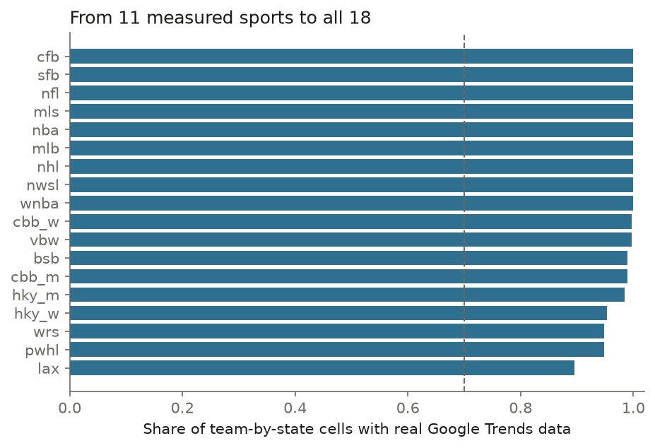
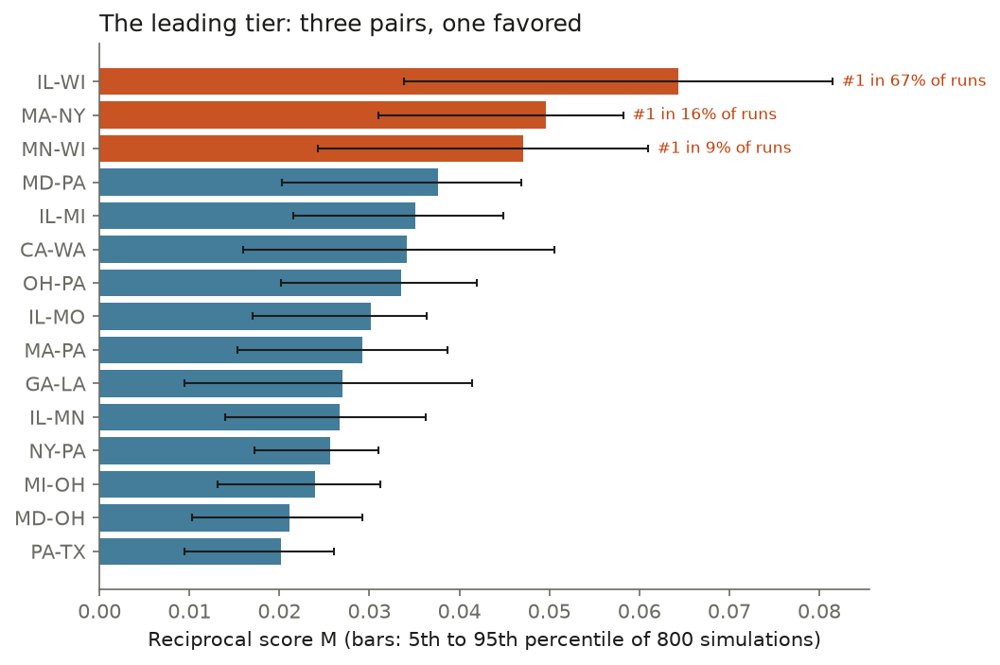
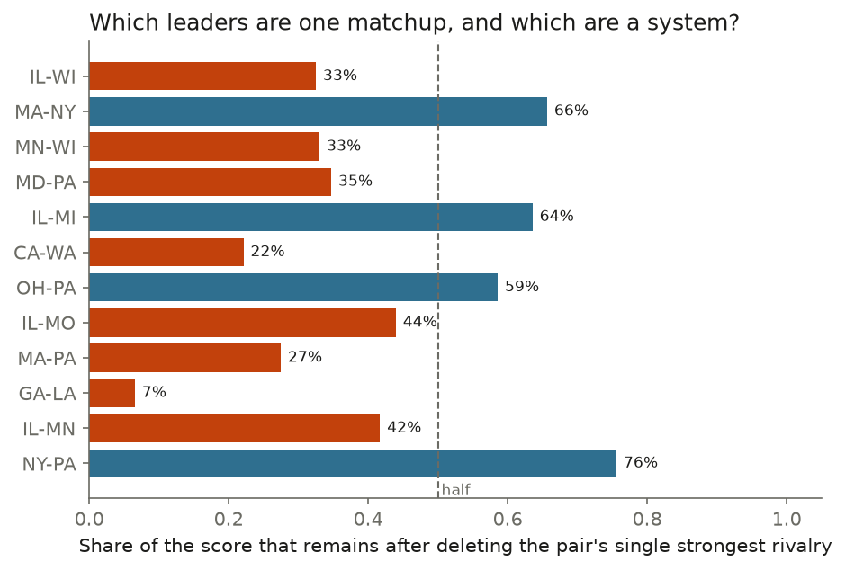
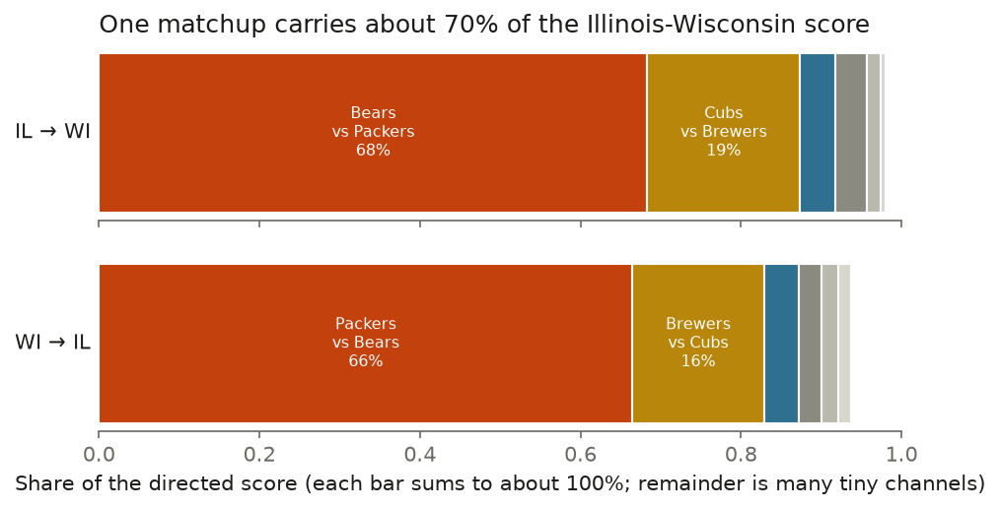
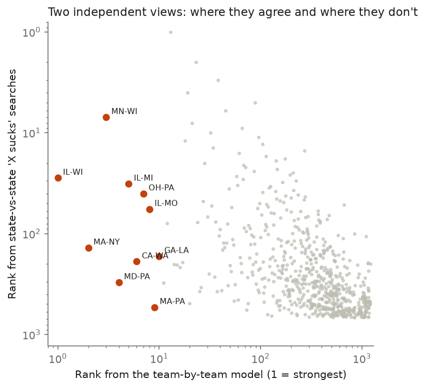
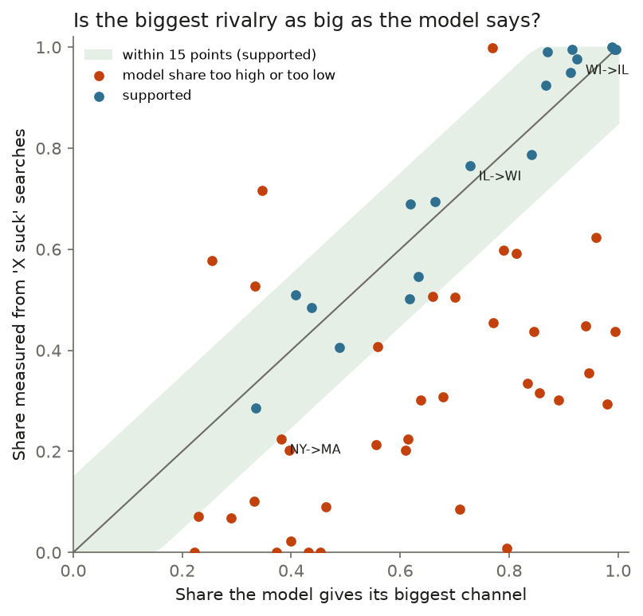
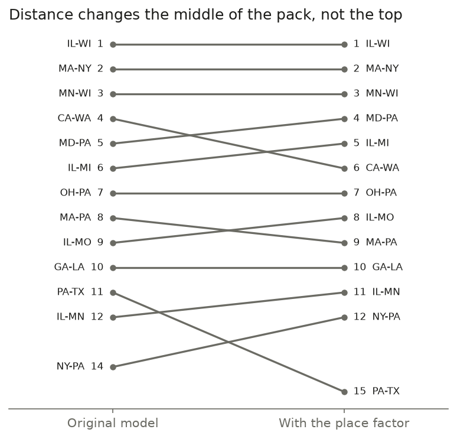
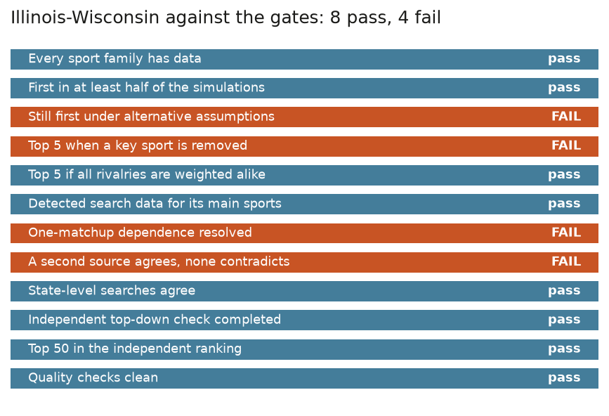

# The Most Hated State in Sports

*How I tried to settle a barroom argument with numbers, what the numbers said, and why I stopped short of naming a winner. The final results are in [`RESULTS.md`](RESULTS.md); this is the story behind them. Numbers in early chapters are the ones I had at the time; where a later review changed them, the chapter says so and gives the final figure.*

---

## Chapter 1. A barroom question

Which two American states hate each other the most when it comes to sports?

People argue about this for hours. Michigan and Ohio. Minnesota and Wisconsin. Texas and Oklahoma. Everyone has a favorite and everyone is sure. I wanted to find out whether the argument could be settled with numbers instead of volume.

I set the rules before I computed anything. No shortlist: all **1,225** pairs of states compete. No points for sharing a border, a famous game, a championship, or because a rivalry "feels" important. The question is about *right now*, about whether the hostility runs in **both directions**, and about the people who actually live in each state, not about where a stadium happens to sit.

The scoring idea fits in a few lines. Fans of a team feel strongest about a handful of rivals. Each rival stands, in the fans' minds, for a place. So a state's hostility toward another state is the sum, over every team its residents follow, of how hot each rivalry burns, pointed at the state each rival represents. A pair's score is the geometric mean of the two directions, so one-sided obsession is punished: a state that despises its neighbor while the neighbor shrugs does not win.

## Chapter 2. Counting who cares about what

Before you can say who hates whom, you have to say who *follows* whom. That meant a registry of every team and program that might matter: not only the NFL, MLB, NBA and NHL, but major-college football, men's and women's basketball, baseball, softball, hockey, volleyball, lacrosse and wrestling. The list grew from 197 teams to **2,558** entities in 18 sport families.

The best free, state-by-state signal for "what do people care about" is how often they search for something. Google Trends reports each state's interest in a term, but only as a *share* among up to five terms, rounded to whole percents, so numbers from different batches cannot be added. My fix was to put two reference terms in every batch and rescale everything to them, like measuring every building against the same two marks on a ruler.

Google also pushes back. It limits how fast a program may ask, and it began refusing requests after about a hundred. I made a rule never to dodge that. The data-gathering program asks slowly, waits out every refusal, restarts itself if it crashes, and keeps a ledger so nothing is lost. The full pull took about two weeks and produced more than 340,000 state-by-team observations.

*From 11 sport families with real data to all 18. The dashed line is the 70% bar my verdict requires.*

## Chapter 3. The first answer, and why I did not believe it

When the first complete version ran, a leaderboard appeared: Illinois and Wisconsin on top, then Massachusetts and New York, then Minnesota and Wisconsin, then California and Washington.

I did not announce a winner. I asked how sure I was. I re-ran the model 800 times, each time nudging every uncertain input by a plausible amount: how much a state follows a team, how hot a rivalry is, how much a team stands for its state. In 73% of those first runs Illinois–Wisconsin came out first, and in 97% it finished in the top three. (After every correction described below, the final figures are 66.9% and 94.8%.) A clear favorite, not a certainty.

*Three pairs can win and one is favored. The thin bars show how much each score moves when the inputs are nudged.*

## Chapter 4. Not so fast: the Bears and the Packers

The first real stress test: take the single strongest rivalry between two states and delete it. Does the pair still look like a rivalry, or was it one famous game dressed up as a state feud?

For Illinois and Wisconsin the answer was uncomfortable. Remove **Bears versus Packers** and the pair keeps only a third of its score (33%), sliding from first place to about fifteenth. For Massachusetts and New York two thirds of the score survives (66%), because it is spread over Yankees–Red Sox, Patriots–Jets, Celtics–Knicks and more.

*What is left of each leader's score after deleting its single strongest rivalry.*

The channel breakdown shows why: 68% of Illinois's hostility toward Wisconsin runs through a single pair of teams.

My rule was written down in advance: a pair that collapses without its strongest matchup cannot be declared the winner without further evidence. That left me with a leading tier rather than a champion, and one question to answer.

## Chapter 5. Is that 68% real?

The right response to "one matchup carries two thirds of the score" is not "so the model is wrong." It is: **is that what reality looks like, too?**

If most of what makes Illinois and Wisconsin fans dislike each other really is Bears–Packers, a single dominant rivalry is simply the truth, and a pair built on it can legitimately win. If reality is more like 40%, my model has the rivalry too hot. And the model's rivalry numbers are mostly judgment calls: a ladder of tiers that I wrote down. The data I had measured *who follows whom*, not *how much each rivalry matters*.

A second objection sharpened the first. A Celtics fan in Massachusetts may dislike the Lakers, but that is two famous brands with fans everywhere, not Massachusetts against California. By default the model turns every team rivalry into a state rivalry, which quietly credits brand feuds to state pairs.

There is an independent check. A separate, simpler measurement asks only how often people in one state search "[other state] sucks". It ignores teams entirely. When the two views are plotted against each other, the Midwestern pairs hold up in both and the brand-driven pairs do not.

*Each dot is a pair of states. The labeled red dots are the team-by-team model's top ten. Minnesota–Wisconsin and Illinois–Wisconsin are also near the top of the state-level searches. Massachusetts–New York, California–Washington and Maryland–Pennsylvania are not.*

## Chapter 6. Testing the antipathy and the rivalry ladder

For every NFL, MLB, NBA and NHL team I pulled how often each state searches "[team] suck" and asked whether the teams people complain about match the teams the model says each state should be most hostile to. Football agrees moderately (mean within-state rank correlation 0.41), baseball a little less (0.33), basketball weakly (0.21); hockey could only be tested in three states. One lesson along the way: my first read was fooled by fans complaining about their *own* teams ("Bears suck" is searched plenty in Illinois), so the comparison now drops each state's own teams, since the model deliberately ignores in-state hostility.

Then I tested the ladder itself. The model ranks rivalries in three tiers: a top-tier rivalry is worth 1, a second-tier one about 0.38, a third-tier one about 0.11. I wrote those numbers by hand. Could the antipathy searches check them? For every state and every NFL team I asked how much a state's dislike of a team rises with the attention it pays to teams that rival it at each tier, after allowing each state its own search habits and each team its own baseline unpopularity.

For the NFL, second-tier rivalries come out at **0.41** (my prior: 0.38) and third-tier at **0.11** (prior: 0.106). To within the noise, the ladder I guessed is the ladder the data prefer. For baseball and basketball the data cannot pin the ladder down (the interval spans more than a factor of twenty), so for those sports my numbers are neither confirmed nor contradicted. This tests how much hotter a bigger rivalry is. It does not test the harder claim, that one matchup carries two thirds of Illinois–Wisconsin.

## Chapter 7. Is the Bears–Packers share real? The test

For each of the strongest state pairs, in each direction, I took every team and school that stands for the target state and asked two questions: what share of the model's hostility flows through each one, and what share of the *searches* ("[team] suck", by state) is aimed at each one? Where the two shares are within 15 percentage points, the model's weight is supported.

My first version of this test was graded on a favorable number, and a review caught it (Chapter 12). The final result: for Illinois toward Wisconsin the model gives the Packers 73% and the searches say 77%, so the dominance is **supported on the raw share**. But the same comparison cannot be made on the ambient-corrected measure, because the Brewers and Marquette, which carry a fifth of the model's weight, do not register in enough states. And Wisconsin toward Illinois cannot be tested at all, because too few Chicago teams register in Wisconsin's searches. So Bears–Packers is clearly the biggest matchup between the two states, but how dominant it is remains open.

Across the top 30 pairs, 55 directions could be computed and 23 were testable (at least three teams actually detected, covering 80% of the model's weight). Only **2 of the 23 are supported**, 1 more on the raw measure alone, and in **11** the model gives its biggest channel too large a share; in the other 9 the corrected comparison could not be made. The model is systematically too *concentrated*: it routes most of a state's hostility through one famous matchup, while real antipathy is spread across more teams. The over-concentrated cases are mostly the ones you would suspect, brand rivalries the model credited to states, such as California and Washington (49ers–Seahawks) and Massachusetts and Pennsylvania (Celtics–76ers).

## Chapter 8. A fair worry: is it just the season, or how often they play?

A question from my own gut: what if Bucks–Bulls matters hugely but looks small because the NBA is in its off-season while the Bears and Packers played last week? And what if thirteen baseball games against two football games bias the numbers in either direction, with more chances to look things up on one side and more fatigue on the other?

I built the windows to prevent exactly the first problem. Every window is a whole number of years ending on the same date, so each sport's full season, off-season included, is inside every window. A direct check agrees: interest in a team over the last twelve months and over the year before correlate closely (rank correlation 0.83 for the NFL, 0.91 for MLB, 0.73 for the NBA, 0.77 for the NHL, 0.90 for college football), and a model run on the most recent window alone changes the ranking by almost nothing.

For the second, public schedules (nflverse for football, MLB's open stats API for baseball) let me test it. Football comes out positive and baseball negative, which fits "either direction", but both estimates are implausibly large and baseball's interval is enormous. How often two teams meet is almost the same thing as being division rivals, which the rivalry tiers already capture. So I keep meetings per season as a diagnostic and do not use it as a correction. Season length and schedule differences are not where the story is.

## Chapter 9. A score built from searches alone

If my rivalry tiers are guesses, how would the ranking look without them? I built a second score using nothing but the antipathy searches: for each state, how strongly its residents search against every team or school that stands for another state, added up. No tiers, no attention weights, no temperature.

It can be computed for 73 pairs where both directions were measured well. Among those, **Illinois–Wisconsin ranks first**, **Michigan–Ohio second** (13th in the model) and **Minnesota–Wisconsin third**. Massachusetts–New York drops to 12th, California–Washington to 20th and Maryland–Pennsylvania to 38th. The two rankings agree only moderately (rank correlation 0.51 across those pairs), but the tilt is the one the state-level searches predicted: Midwestern pairs with a shared, place-based rivalry come up, and pairs built on distant famous brands come down.

The measurement also says something about the "one rivalry" question. In the Wisconsin-to-Illinois direction essentially all of the measured hostility is the Bears (an effective number of channels of 1.1); Illinois toward Wisconsin has about two. Whether that makes Illinois–Wisconsin a *state* rivalry or just a very big team rivalry is the next question, and I decided to judge it by independent evidence of state-level framing, not by how many channels it has.

## Chapter 10. The average-resident test

At this point I added the rule that now guards the whole project: *would the average resident, not the most passionate fan, plausibly feel this about the other state?* A typical Californian, even a big Lakers fan, does not resent Massachusetts because of Celtics–Lakers. A typical Madison resident who barely follows football does resent Minnesota, because that rivalry has soaked into the culture.

That is a testable claim about distance. Holding the model's own predictions fixed, antipathy toward a team falls to about **70% for every 1,000 miles** in the NFL (90% interval 0.65 to 0.77) and 73% in MLB, with a smaller drop in the NBA. Far-off brand feuds are weaker than the team-level math says; neighbors are stronger. I added a place factor to the model (protocol revision D-016): hostility toward a team shrinks by exp(−0.33 per 1,000 miles), applied to every pair alike, with the original ranking published next to the final one. It moves the brand pairs most (California–Massachusetts falls from 13th to 41st) and leaves the leading three exactly where they were, because the leaders are neighbors.

The test also says what teams cannot tell me: how far a rivalry spreads among people who do not follow sports. That is visible only in state-level searches, which is why I kept those as an independent check.

## Chapter 11. Which of the leaders are really state rivalries?

I wrote the thresholds down first, though after I already knew the lead pairs' state-level ranks (a disclosure I repeat in the limitations). A leading pair is *corroborated* if it clears three conditions that do not depend on the team model: people search against the **state** itself (top 5% of the 677 pairs that could be measured in both directions, so rank 33 or better), a searches-only score does not contradict it, and the hostility is reciprocal (the weaker direction is at least 40% of the stronger).

**Corroborated:** Illinois–Wisconsin (28th of the 677, first in the searches-only score), Minnesota–Wisconsin (7th and 3rd) and Illinois–Michigan (32nd; not scored by the searches-only measure). Illinois–Wisconsin and Minnesota–Wisconsin are *marquee-matchup* rivalries: in at least one direction the hostility runs through essentially one matchup. That does not weaken them. It says what kind of rivalry they are: one enormous, state-owned matchup (Bears–Packers; Vikings–Packers plus the Gophers–Badgers football and hockey games) rather than a web of many.

**Not corroborated:** Massachusetts–New York (second in the model, but 138th of the 677 in state-level searches), California–Washington, Maryland–Pennsylvania, Ohio–Pennsylvania (40th), Illinois–Missouri (57th), Georgia–Louisiana, Massachusetts–Pennsylvania, Illinois–Minnesota and New York–Pennsylvania. These look more like feuds between teams in two states than rivalries between the states, or simply fall outside the strict cutoff.

One caution: "New York sucks" is a noisy search (it also means the city and many things that are not sports), so Massachusetts–New York's state-level rank may be too low.

## Chapter 12. Rules I wrote after the fact, and the reviewer who noticed

Everything above led to two changes to my rules, both recorded as protocol revisions with their reasons: the place factor (D-016, Chapter 10) and a refined verdict rule (D-017). The original rule said a pair that loses most of its score without its strongest rivalry cannot be the winner. That is a fair fragility test, but it cannot tell a flimsy rivalry from one that is simply enormous. The refined rule asked the better question: is that one matchup really that big a share of what the two states feel, in both directions, and is the pair corroborated by evidence the team model never saw?

I wrote the refined rule's text before I examined the channel measurements, but I adopted it after seeing them and after Illinois–Wisconsin had failed the original gate. I first described it as "pre-registered". It was not, and a review made me stop saying so; the limitations register now states exactly what the order of events was.

I then asked a separate reviewer, who had not written any of the code, to attack the result. It found real problems, and they check out:

- **The dominance test was graded on the favorable number.** The share of Bears–Packers passed the 15-point rule on the raw measure (model 74%, measured 77%) but missed it on the ambient-corrected measure (58%, 15.8 points away), and my code had used only the raw one. The other direction rested on two measured teams, so a 98% share was nearly automatic.
- **The sport-level weights for college sports were an artifact.** They came from literal search phrases such as "men's college basketball", which gave college basketball a weight of 0.002 against 0.37 for the NFL. That almost certainly suppressed rivalries driven by basketball (Kansas–Missouri, Indiana–Kentucky, Illinois–Missouri, Connecticut–Tennessee). In addition, 61 to 93 percent of college team-by-state cells were below detection, and I had been counting them as "measured".
- **Smaller but real:** 72 rivalry edges were listed twice; the estimator threw away censored observations whenever any detected one existed, biasing low-interest teams upward; a failed step in the pipeline could be hidden; the place factor's own uncertainty was missing from the simulations; several generated texts contradicted each other; and the repository could not have been published (a 112 MB file, and traces of a local path and an email address in its history).

I fixed all of it the same day. The dominance gate now requires support on **both** the raw and ambient-corrected measures, in **both** directions, with enough measured units (at least three, covering 80% of the model), plus a second independent proxy. Censored cells are bounded, never dropped or zeroed. Duplicate edges are gone, the estimator keeps censored information, the simulations draw the place factor's uncertainty, pipeline failures stop the build, and the generated texts now come from the verdict file.

*The place factor reshuffles the middle of the pack and leaves the top where it was.*

## Chapter 13. Re-measuring college sports properly

The reviewer's sharpest finding was about the weights that say how much of a state's attention goes to each sport. For college sports these had been measured with literal search phrases, and people simply do not search for "men's college basketball". I redid the sport-level terms with Google topic ids, which gather every way people refer to a sport, on the same NFL and MLB reference terms.

The old numbers really were an artifact. The men's basketball tournament topic comes in at about **10% of the NFL's search volume**, roughly seventeen times the phrase measure. Women's basketball rose three and a half times. College football barely changed, and baseball, softball, volleyball and wrestling are so small next to the NFL that they sit at the detection floor either way.

The effect on the story was smaller than I feared. Basketball corridors rise (Kansas–Missouri from 34th to 19th, Indiana–Kentucky from 253rd to 61st, North Carolina–Virginia from 509th to 215th), but the top of the ranking does not move: Illinois–Wisconsin, Massachusetts–New York and Minnesota–Wisconsin stay first, second and third, and the whole ranking correlates 0.99 with the old one. Illinois–Wisconsin is first in about 67% of simulations (it was 71%) and stays the favorite. One caution survives: the very small sports cannot be resolved against an NFL-sized reference, so their sport-level weights are upper bounds, not measurements.

## Chapter 14. Closing the open items, and a source that has nothing to do with Google

**Does the distance effect hold for a different kind of team?** Yes. College schools, measured separately, show antipathy shrinking to about **0.77 per 1,000 miles** (interval 0.71 to 0.83), squarely in the range of the pro teams.

**Where does the simulation noise come from?** I had originally chosen the noise levels by judgment. Now they are derived from how far the model actually misses the measured antipathy: about 0.3 to 0.4 on a log scale per state-team pair, against about 0.07 for Google's own sampling noise. Converted to a per-rivalry error that is close to what I had assumed. One piece remains my choice, because a sport-wide scale error cannot be identified from team-level data.

**Does a team stand for its state?** The model gives nearly every team 95% by default. A first measurement compares how hostility toward a team and toward its home state move together across the rest of the country. It agrees with intuition where it can be computed: the Packers move closely with Wisconsin (+0.80) and the Vikings with Minnesota (+0.83), while the Bears (+0.46) track Chicago more than they track Illinois. It could only be computed for 40 teams and schools, and politics blurs it, so I record it as exploratory.

**What do Wikipedia readers see?** As a check from a completely different place, I counted how many people read Wikipedia's rivalry articles (for 68 rivalries that have one), divided by how many read the two teams' own pages so that team fame cancels out. Tier-2 rivalries come out at **0.36** of tier 1 (my prior: 0.38), almost exactly right. Tier 3 comes out at **0.27** (prior: 0.11), partly because only well-known third-tier rivalries have articles; re-ranking all pairs with the readers' tier-3 weight leaves Illinois–Wisconsin first and the whole ranking at a 0.99 rank correlation. The honest limit: Wikipedia is national, so it speaks to the *ladder* but not to the state-level geography.

## Chapter 15. A second reviewer, a bug in the new test, and gates with the padding removed

After the fixes, a second reviewer, with no memory of the first, checked that each earlier finding had really been fixed and hunted for new problems. It found one real bug and several places where my write-up claimed more than the data showed.

**The bug.** The ambient-corrected comparison for Illinois toward Wisconsin had been computed over three teams on the measured side but over five on the model side. That mismatch, not the evidence, let it pass the 15-point tolerance (by 0.09 points). With the same teams on both sides the corrected comparison cannot be made at all. Intervals that had flipped upside down for censored cells were also fixed: a below-detection cell is now bounded between zero and twice its floor.

**The witnesses.** Wikipedia readers put about 90% of the Illinois–Wisconsin rivalry reading on Bears–Packers, against the model's 78 to 80%. But Google comparison searches ("Bears vs Packers") disagree in both directions: in Illinois the matchup is about 55% of the comparison searching (model 74%), and in Wisconsin only about 37% (model 76%). Wisconsinites search "Brewers vs Cubs" far more than the model expects. An earlier draft of mine said the Illinois comparison agreed; the data say it does not, and I corrected the text.

**The padded gates.** Two gates had been passing almost by construction: the robustness gate counted near-identical variants (ranking correlation 0.99 or more with the base) that cannot change an answer, and the leave-one-sport-out gate counted sports, like softball, that have nothing to do with a football pair. With only the informative tests counted, Illinois–Wisconsin is first in 3 of 5 variants, not the 80% required: under a flat-tier prior Massachusetts–New York leads, and under flat sport weights Minnesota–Wisconsin does. Without football it is fifth; without all professional sports it is 206th.

A third review, run on the release candidate, found the last round of issues: a state-level rank quoted against 1,225 pairs when it was out of the 677 measured in both directions (which made Ohio–Pennsylvania and Illinois–Missouri drop out of the corroborated set), stale numbers and over-claims in the report and in this story, stage ordering in the build, and a reproduction path that did not work from the repository alone. All fixed; the verdict did not change.

## Chapter 16. The answer that is not final

So which two states hate each other the most, in sports?

The most defensible answer is this: **Illinois and Wisconsin are the leading candidate under my model's assumptions, and the evidence stops short of a verdict.**

What supports it. Under the model's own assumptions Illinois–Wisconsin comes first in about two thirds of the simulated worlds and in the top three in about 95% of them. Searches against the *states* themselves put the pair 28th of the 677 measurable pairs (the top 4%), and a score built only from antipathy searches ranks it first among the 73 pairs where that can be computed. It is a **marquee-matchup** rivalry, Bears against Packers, and an independent source that has nothing to do with Google (how many people read Wikipedia's rivalry articles) agrees that Bears–Packers dwarfs every other matchup between the two states. Distance, which the model once ignored, barely moves it: the leaders are neighbors.

What does not. Illinois–Wisconsin is not the most reciprocal pair (its two directions differ by about a third, while Michigan–Ohio is nearly balanced), and it does not top the independent state-level searches either: Michigan–Ohio, Oklahoma–Texas, Alabama–Georgia and Kansas–Missouri rank above it there. The Bears track Chicago more than Illinois in the embodiment check, although the model credits them fully to Illinois. Take away my judgments about how hot each tier of rivalry burns, or about how much attention each sport gets, and Illinois–Wisconsin no longer wins: Massachusetts–New York leads under one, Minnesota–Wisconsin under the other. Without football it drops to fifth, and without all professional sports out of sight. Across the top 30 pairs only 2 of the 23 testable directions have the model's biggest channel confirmed by the measurements. Whether Bears–Packers is as dominant as the model says is supported on the raw searches in one direction, untestable on the corrected measure and in the other direction, and contradicted by comparison searches in *both* states. Four of the twelve gates fail, and each failure is a fair one.

That is why the answer is not final. It is not that the work was unfinished. It is that the honest result of this method on this data is a leading tier, a favorite, and a list of exactly what would turn the favorite into a winner or knock it down: measured rivalry weights in place of mine, a second independent source that has geography in it, and enough detected data in small states to test the other direction.

## What I took from it

- **A good question needs a falsifiable machine.** Every claim above traces to a table in the repository, and every number was checked by something other than the model that produced it.
- **Gates that cannot fail are decoration.** Two of mine had been quietly passing by construction until a reviewer noticed.
- **Your own results deserve the hardest review.** Three review passes on three consecutive days each found real problems, including a bug in a test I had written the hour before and prose that claimed more than the data showed. The project got better, and the claim got smaller each time.
- **Small-state data is thin.** Most of the college data cells (61 to 93 percent in several sports) sit below the detection limit of a free public search tool. That is a property of the tool, and the single biggest thing the official API might fix.
- **The gut check was the best statistic.** "Would the average resident feel this?" led to the distance finding, to the corroboration test, and to separating a rivalry between two *teams* from a rivalry between two *states*.

## Epilogue

The barroom answer was Michigan–Ohio, or Minnesota–Wisconsin, or Texas–Oklahoma, and the argument will go on. What the numbers add is narrower: if one pair has to be named, the best-supported candidate my method and public data can offer runs between Chicago and Green Bay, and the main thing keeping that from being a verdict is how little a free tool can see of Wisconsin, and how much the answer still depends on the judgments I started with.

*The limitations register is [`LIMITATIONS.md`](LIMITATIONS.md); the methods are [`METHODS.md`](METHODS.md); the dated record of what changed is [`TIMELINE.md`](TIMELINE.md).*
